# Contract: Core Consultation Flow (behavioral, plain language)

**Feature**: 001-iching-consultation (updated by 004-user-cast) | Covers: FR-001…FR-018, User Stories 1–3, and manual User cast | **Date**: 2026-11-15

This is the behavioral contract for the consultation ritual — what the app must do at every state, independent of implementation. It is the reference for `tasks.md` acceptance criteria and for the pure `src/core/` state-machine tests.

## State machine

```mermaid
stateDiagram-v2
    [*] --> Question : app opened (method = default coins unless opted-in memory)
    Question --> Question : edit question / change method / read explanation
    Question --> Casting : "Cast" pressed (question may be empty)
    Casting --> Casting : automatic reveal next / "Reveal all", or manual select 6–9 + "Add line" / "Undo last line"
    Casting --> Result : six lines confirmed or revealed
    Result --> Question : "Cast again" (fresh consultation, nothing carried over; session method retained)
    Question --> Question* : secure-random unavailable & automatic method selected ⇒ "Cast" disabled (honest message shown; User cast remains enabled)
```

States: **Question** (idle/first screen combines the short explanation and the optional question), **Casting** (lines arriving automatically or entered bottom-up by hand), **Result** (contemplation; includes related hexagram subsection when any line changed). Method choice (`coins`, `yarrow`, or `user`) is an affordance of the Question state, not a state of its own, and is fixed once Casting begins.

## Contract clauses

**C-1 Step discipline (FR-001)** — Exactly one of the three step views is visible at any time. No result data is rendered while in Question; no question editing or method switching is possible mid-Casting.

**C-2 Question (FR-002, FR-023)** — The question field is optional; casting with it empty must succeed. Text over 500 characters is truncated with a clear notice. The question exists only in memory: never written to storage, never included in any output artifact, and nulled when the consultation is discarded.

**C-3 Casting integrity (FR-003, R-4 of research; 004 FR-011/FR-012)** — On open, the app probes once for `crypto.getRandomValues`. For automatic methods (`coins`, `yarrow`), if `crypto.getRandomValues` is unavailable: the Cast control is disabled and a plain message states automatic casting is unavailable on this device and why; the app never casts from a weaker source. When available, each of the six automatic lines is drawn independently under the active method's model (three-coin default: 6:1/8, 7:3/8, 8:3/8, 9:1/8; yarrow: 6:1/16, 7:5/16, 8:7/16, 9:3/16 — note mapping orientation: old yang 9 is 3/16 for yarrow, old yin 6 is 1/16). **User cast** (`user`) is excluded from the secure-randomness refusal: it uses zero random draws, instead accepting six user-confirmed final line values (`6`, `7`, `8`, or `9`), and remains available when `crypto.getRandomValues` is absent.

**C-4 Line reveal and manual entry (FR-004, FR-006, FR-017; 004 FR-004…FR-011)** — Lines appear one at a time in order position 1 (bottom) → 6 (top). Each line displays polarity (solid yang bar / broken yin bar) and, if changing, a `○`(old yang)/`✕`(old yin) marker plus the word "changing" — never color alone. Each line is announced to assistive technology as text naming position, line type, and changing status. In automatic mode, a keyboard-operable "Reveal all" control completes the sequence immediately. In User cast, "Reveal all" and automatic timers are absent; the seeker taps, clicks, or keyboard-selects one of four distinct numbered final-value targets (`6`, `7`, `8`, `9`, each at least 44 by 44 CSS pixels, with no text/numeric input field), confirms each line explicitly with "Add line" (consuming the selection), and may remove the latest confirmed line with "Undo last line" until line 6 is confirmed.

**C-5 Result content (FR-007, FR-008)** — The Result state must display: hexagram figure; King Wen number; name; upper and lower trigram names; judgement text; image text; visible translation attribution. The hexagram identity must equal `PATTERN_TO_KW[bitpattern]` with bit 0 = bottom line (data-model §3), derived identically for automatic and manual consultations only after all six lines are present.

**C-6 Related hexagram (FR-009, FR-010)** — If one or more lines changed **including all six**: display the related hexagram = pattern with exactly the changing positions flipped, with its own number, name, judgement, image. If zero lines changed: no related hexagram section exists; display the stable message ("no changing lines — the hexagram is stable"), worded neutrally so it does not imply a lesser cast. All-six-changing is an ordinary case of FR-009 (e.g. pattern of 1 flips to 2), not an edge case in logic.

**C-7 Contemplative framing (FR-011, FR-014, US-3)** — Every app-authored string is sober and neutral; nothing anywhere predicts, guarantees, or gives medical/legal/financial advice. A short in-app explanation states what an I Ching consultation is and that the app makes no predictions; corpus texts appear only as attributed quotations.

**C-8 Cast again (FR-012; 004 FR-014)** — The single "Cast again" action returns to Question with a brand-new Consultation: question field empty, pending manual choices cleared, no lines, no result data, summaries collapsed and cleared, no previous cast anywhere in the DOM (nodes for the prior cast are removed/cleared, not hidden), while retaining the active in-session method and moving focus to the visible Question heading.

**C-9 Method choice (US-2, A-4/FR-022; 004 FR-015)** — All three methods (`Three coins`, `Yarrow stalks`, `User cast`) are selectable at Question; selection is visibly indicated. Within one app opening the last selection remains active for subsequent casts. On each new opening the default is three-coin **unless** the seeker has opted in to remembering the method (`iching.method` storing only `coins`, `yarrow`, or `user`; consent gate; opt-out deletes the stored value immediately; questions, entered line values, and results are never stored; storage failures degrade to session-only without errors).

**C-10 Inert input (FR-013)** — Any seeker-entered text (only the question, displayed back on the Result screen) is rendered as literal text; angle brackets, quotes, and script-like sequences display as typed and cannot execute or alter layout structure. Manual line values use discrete radio choices validated strictly against `6`, `7`, `8`, and `9` at both UI and core boundaries.

**C-11 Interruption (edge cases)** — Reload or back-navigation mid-Casting restarts at Question; no partial cast can display as a result (results exist only for complete six-line consultations, and no cast state is persisted).

**C-12 Keyboard & screen reader (FR-016/017, NFR-004; 004 FR-016)** — Every action (question entry, method change, cast, automatic reveal-all, manual value choice, add line, undo last line, cast again, explanation/summary toggles, preference opt-in/out) is reachable and operable by keyboard alone with a visible focus indicator; the full ritual is completable with assistive technology only, receiving numbers, positions, and names of hexagrams and lines as text without sixth-line confirmation overwriting the result announcement.

**C-13 No network, no storage side effects (FR-019/021/023, NFR-003)** — The flow performs zero network requests under any path, and the only storage write is the opted-in method identifier (`iching.method`). Opening the file from any location grants no additional capability.

## Out of scope (v1, by spec)

Line-by-line texts, multi-changing-line reading conventions, history/export, multiple languages, themes beyond system light/dark contrast handling.
