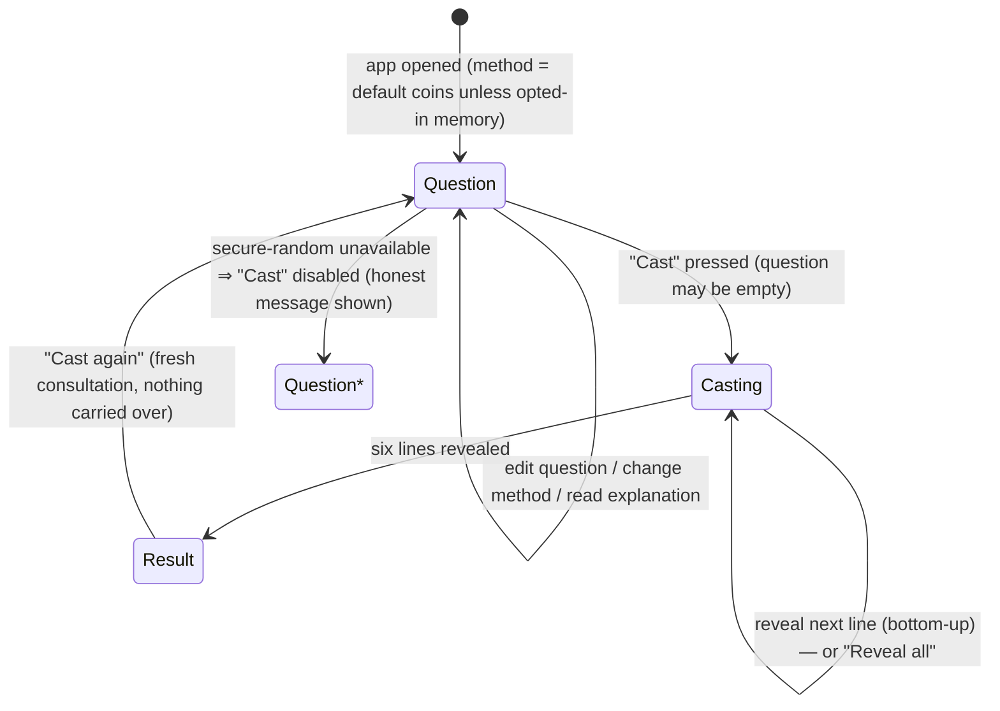

# Contract: Core Consultation Flow (behavioral, plain language)

**Feature**: 001-iching-consultation | Covers: FR-001…FR-018, User Stories 1–3 | **Date**: 2026-11-09

This is the behavioral contract for the consultation ritual — what the app must do at every state, independent of implementation. It is the reference for `tasks.md` acceptance criteria and for the pure `src/core/` state-machine tests.

## State machine

States: **Question** (idle/first screen combines the short explanation and the optional question), **Casting** (lines arriving), **Result** (contemplation; includes related hexagram subsection when any line changed). Method choice is an affordance of the Question state, not a state of its own.

## Contract clauses

**C-1 Step discipline (FR-001)** — Exactly one of the three step views is visible at any time. No result data is rendered while in Question; no question editing is possible mid-Casting.

**C-2 Question (FR-002, FR-023)** — The question field is optional; casting with it empty must succeed. Text over 500 characters is truncated with a clear notice. The question exists only in memory: never written to storage, never included in any output artifact, and nulled when the consultation is discarded.

**C-3 Casting integrity (FR-003, R-4 of research)** — On open, the app probes once for `crypto.getRandomValues`. If unavailable: the Cast control is disabled and a plain message states casting is unavailable on this device and why; the app never casts from a weaker source. When available, each of the six lines is drawn independently under the active method's model (three-coin default: 6:1/8, 7:3/8, 8:3/8, 9:1/8; yarrow: 6:1/16, 7:5/16, 8:7/16, 9:3/16 — note mapping orientation: old yang 9 is 3/16 for yarrow, old yin 6 is 1/16).

**C-4 Line reveal (FR-004, FR-006, FR-017)** — Lines appear one at a time in order position 1 (bottom) → 6 (top). Each line displays polarity (solid yang bar / broken yin bar) and, if changing, a `○`(old yang)/`✕`(old yin) marker plus the word "changing" — never color alone. Each reveal is announced to assistive technology as text naming position, line type, and changing status. A "Reveal all" control completes the sequence immediately (keyboard operable).

**C-5 Result content (FR-007, FR-008)** — The Result state must display: hexagram figure; King Wen number; name; upper and lower trigram names; judgement text; image text; visible translation attribution. The hexagram identity must equal `PATTERN_TO_KW[bitpattern]` with bit 0 = bottom line (data-model §3).

**C-6 Related hexagram (FR-009, FR-010)** — If one or more lines changed **including all six**: display the related hexagram = pattern with exactly the changing positions flipped, with its own number, name, judgement, image. If zero lines changed: no related hexagram section exists; display the stable message ("no changing lines — the hexagram is stable"), worded neutrally so it does not imply a lesser cast. All-six-changing is an ordinary case of FR-009 (e.g. pattern of 1 flips to 2), not an edge case in logic.

**C-7 Contemplative framing (FR-011, FR-014, US-3)** — Every app-authored string is sober and neutral; nothing anywhere predicts, guarantees, or gives medical/legal/financial advice. A short in-app explanation states what an I Ching consultation is and that the app makes no predictions; corpus texts appear only as attributed quotations.

**C-8 Cast again (FR-012)** — The single "Cast again" action returns to Question with a brand-new Consultation: question field empty, no lines, no result data, no previous cast anywhere in the DOM (nodes for the prior cast are removed/cleared, not hidden).

**C-9 Method choice (US-2, A-4/FR-022)** — Both methods are selectable at Question; selection is visibly indicated. Within one app opening the last selection remains active for subsequent casts. On each new opening the default is three-coin **unless** the seeker has opted in to remembering the method (consent gate; opt-out deletes the stored value immediately; storage failures degrade to session-only without errors).

**C-10 Inert input (FR-013)** — Any seeker-entered text (only the question, displayed back on the Result screen) is rendered as literal text; angle brackets, quotes, and script-like sequences display as typed and cannot execute or alter layout structure.

**C-11 Interruption (edge cases)** — Reload or back-navigation mid-Casting restarts at Question; no partial cast can display as a result (results exist only for complete six-line consultations, and no cast state is persisted).

**C-12 Keyboard & screen reader (FR-016/017, NFR-004)** — Every action (question entry, method change, cast, reveal-all, cast again, explanation toggle, preference opt-in/out) is reachable and operable by keyboard alone with a visible focus indicator; the full ritual is completable with assistive technology only, receiving numbers and names of hexagrams and lines as text.

**C-13 No network, no storage side effects (FR-019/021/023, NFR-003)** — The flow performs zero network requests under any path, and the only storage write is the opted-in method preference. Opening the file from any location grants no additional capability.

## Out of scope (v1, by spec)

Line-by-line texts, multi-changing-line reading conventions, history/export, multiple languages, themes beyond system light/dark contrast handling.
