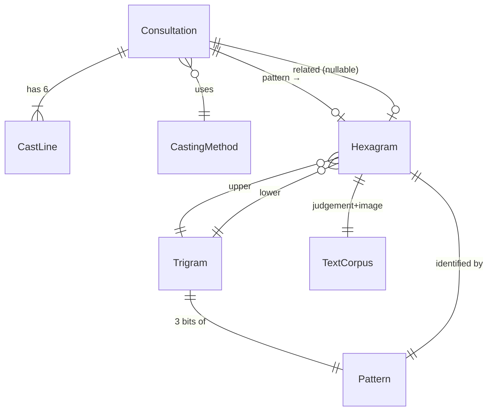

# Phase 1 Data Model: I Ching Consultation App

**Spec**: `specs/001-iching-consultation/spec.md` (§Key Entities) | **Research**: `research.md`
Every entity below maps to a spec Key Entity and lives in `src/core/` (behavior) or `src/data/` (static records). The UI layer (`src/ui/`) holds no domain state beyond the transient consultation itself.

---

## 1. LineValue (cast line value)

A cast line's value — the traditional changing-numbers integer. **Maps to**: spec *Line*.

| Value | Name | Polarity | Changing | Marker |
|---|---|---|---|---|
| 6 | old yin ( Six / "6 in the … place") | yin | yes | `✕` |
| 7 | young yang (seven) | yang | no | — |
| 8 | young yin (eight) | yin | no | — |
| 9 | old yang (nine) | yang | yes | `○` |

**Type**: `type LineValue = 6 | 7 | 8 | 9`.
**Derived**: `isYang(v) = (v & 1) === 1` · `isChanging(v) = v === 6 || v === 9`.
**Validation**: value ∈ {6,7,8,9}; no other construction path exists (TS literal union + runtime assert in `castLine` decoding for injected sources).

## 2. CastLine

One of the six cast lines. **Maps to**: spec *Line* (position + value + changing flag).

| Field | Type | Notes |
|---|---|---|
| `position` | `1..6` int | 1 = bottom (first cast, FR-004) |
| `value` | `LineValue` | |
| `changing` | `boolean` | derived cache of `isChanging(value)` |

**Validation**: exactly six CastLines per Consultation, one per position; `changing === isChanging(value)`.

## 3. Pattern (line pattern)

The canonical six-line binary identity of a hexagram — the join key for all data-integrity tests. **Maps to**: spec *Hexagram*.six-line pattern.

- **Representation**: integer `0..63`; **bit 0 = position 1 (bottom)** … bit 5 = position 6 (top); bit set = yang, clear = yin (research R-3).
- `patternFromLines(lines: CastLine[]): number` — sets bit *p−1* when position *p* is yang.
- Changing-position mask: bit *p−1* set when position *p* is changing.
- **Transformation**: `relatedPattern = pattern ^ mask` (R-3). By construction the mask's positions are cleared of changing status in the related hexagram; `mask === 0` ⇒ **stable**: no related hexagram exists or is computed for display (FR-010).

## 4. Trigram

One of eight three-line figures. **Maps to**: spec *Trigram*.

| Field | Type | Notes |
|---|---|---|
| `id` | `0..7` | index into table |
| `name` | string | e.g. "Ch'ien / The Creative (Heaven)" — Legge's names |
| `nature` | string | element/nature, e.g. "Heaven" |
| `bits` | `0..7` | 3-bit pattern, bottom line = bit 0 |

**Tables**: `TRIGRAMS: readonly Trigram[8]`. **Derivation**: lower = `pattern & 0b111`, upper = `pattern >> 3`.
**Validation**: 8 unique `bits`; a hexagram's trigram pair is fully derivable from its `pattern` (test: composition consistent for all 64 — NFR-005).

## 5. Hexagram

One of the 64 canonical figures. **Maps to**: spec *Hexagram*. Composed from two checked-in data tables plus the corpus:

| Field | Type | Source |
|---|---|---|
| `kwNumber` | `1..64` | King Wen sequence number (primary display id) |
| `name` | string | Legge's hexagram name (e.g. "The Creative", data table `HEXAGRAM_NAMES[65]`, index 0 unused) |
| `pattern` | `0..63` | via `KW_TO_PATTERN[kwNumber]` |
| `upper` / `lower` | `Trigram` | derived from `pattern` (above), not stored |
| `judgement` | string | corpus, non-empty (FR-015) |
| `image` | string | corpus, non-empty (FR-015) |

**Mapping tables** (`src/data/king-wen.ts`): `PATTERN_TO_KW: readonly number[64]` and `KW_TO_PATTERN: readonly number[64]` (index = KW 1..64 at 1..64; index 0 sentinel-checked).
**Validation (all automated, NFR-005 / SC-002)**:
1. `PATTERN_TO_KW` values are exactly {1..64} with no duplicates (bijection).
2. `PATTERN_TO_KW[KW_TO_PATTERN[n]] === n` ∀ n∈1..64 and the converse for all 64 patterns (mutual inverses).
3. Trigram composition derivable and tested for all 64.
4. Corpus has non-empty judgement **and** image for all 64 (FR-015).

## 6. CastingMethod

The random model. **Maps to**: spec *Casting Method*.

| Field | Type | Notes |
|---|---|---|
| `id` | `"coins" \| "yarrow"` | coins = default (FR-005) |
| `label` | string | display name |
| `probs` | record `LineValue → number` | coins: 9→1/8, 7→3/8, 8→3/8, 6→1/8; yarrow: 9→3/16, 7→5/16, 8→7/16, 6→1/16 |
| `draw(randomByte: number): LineValue` | pure | byte-partition map (R-4), exact, no modulo |

**Validation**: probabilities sum to 1; exhaustive check that the byte-partition mapping yields exactly the declared counts over bytes 0..255; statistical run ≥100 k draws within 0.5 pp (SC-003).

## 7. Consultation (session)

One seeker's single pass. **Maps to**: spec *Consultation (Session)*. Transient; held in memory only (FR-023).

| Field | Type | Lifecycle |
|---|---|---|
| `question` | `string \| null` | optional (FR-002); truncated ≤ 500 chars (R-11); **never persisted, never transmitted** |
| `method` | `CastingMethod` | active method for the whole cast |
| `lines` | `CastLine[6]` | filled positions 1→6 bottom-up as revealed |
| `pattern` | `0..63` | derived once all 6 lines exist |
| `changingMask` | `0..63` | derived |
| `hexagram` | `Hexagram` | `PATTERN_TO_KW[pattern]` lookup, derived |
| `related` | `Hexagram \| null` | `mask === 0 ? null : transform` (FR-009/FR-010) |

**State**: `empty → asking → casting(k lines revealed) → complete` — see `contracts/consultation-flow.md` state machine. Derived fields are computed on completion, never stored mid-cast (edge case "reload mid-cast": a half-cast can never present as a result because results require a complete 6-line session; no mid-cast state is persisted anywhere).
**"Cast again"** (FR-012): discard the Consultation object; new instance with `question = null`, method = current in-session method (reset to default on each app opening, US-2 scenario 3).

## 8. TextCorpus (translation text set)

The cited public-domain corpus. **Maps to**: spec *Translation Text Set*.

- **Module**: `src/data/texts.ts`, generated by `scripts/gen-corpus.mjs` (research R-2), never hand-edited.
- **Header** (comment block): attribution "James Legge, *The Yi King*, Sacred Books of the East, Vol. XVI, 1882 — public domain", source filename(s), source SHA-256, generator command, "DO NOT EDIT" marker.
- **Shape**: `CORPUS: readonly { judgement: string; image: string }[65]` (index = KW number, 0 unused), plus `CORPUS_ATTRIBUTION: string` displayed in the result step (FR-008 visible attribution).
- **Validation**: entries 1..64 all present, all strings non-empty after trim; attribution present; no Wilhelm/Baynes strings (spot-check checklist, A-3).
- **Wording constraint** (FR-011/SC-006): app-authored strings (labels, help, messages) pass the content checklist in quickstart — no predictions, guarantees, or medical/legal/financial advice; the corpus is presented with its attribution as quoted classical text.

## 9. Preference (opt-in method memory)

The only persisted item (A-4, FR-022).

| Field | Value |
|---|---|
| storage | `localStorage`, key `iching.method` |
| value | `"coins" \| "yarrow"` |
| consent | written only after explicit opt-in toggle; toggle off ⇒ `removeItem` immediately |
| failure mode | all access try/caught; storage disabled ⇒ behaves as in-session-only (NFR-003) |

**Validation**: nothing else is ever written to any storage; question text and cast results never appear in any written value (FR-023 — verifier/test asserts the only storage key touched is `iching.method`).

---

## Entity relationship overview

## Validation rules summary (each → a named unit test, see contracts & quickstart)

| Rule | Source | Test |
|---|---|---|
| 64 unique patterns; KW tables are bijections and mutual inverses | FR-007, NFR-005 | `hexagram-map.test.ts` |
| Trigram composition correct for all 64 | FR-007 | `hexagram-map.test.ts` |
| Transform = XOR mask; related ≠ null iff changes exist; all-64↔all-64 exhaustive | FR-009/010 | `transform.test.ts` |
| 1↔2 and 63↔64 (full flips) are documented pairs | Principle I | `transform.test.ts` |
| Method probabilities exact (byte partition) + ≥100 k within 0.5 pp | FR-005, SC-003 | `casting.test.ts` |
| Corpus complete (64 × judgement+image non-empty) + attribution | FR-015, FR-008 | `corpus.test.ts` |
| Core/data pure (no DOM globals) | constitution | `purity.test.ts` |
| Consultation clears question/cast on new session | FR-012/023 | `consultation.test.ts` |
