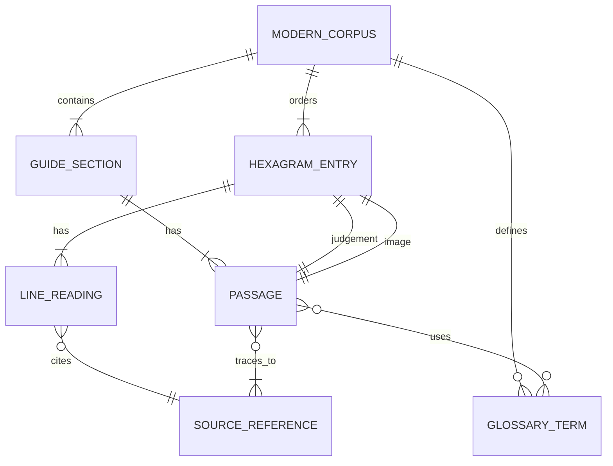

# Phase 1 Data Model: Modern-Prose Corpus

The source is a new structured editorial work, separate from the preserved Legge archive and generated app corpus. Proposed path: `corpus/modern-prose.json`. The renderer and tests consume this validated model; `dist/modern-guide.html` is the sole derived corpus publication and is never edited by hand.

## 1. ModernCorpus

Top-level metadata and ordered publication content.

| Field | Type | Constraints |
|---|---|---|
| `schemaVersion` | string | Version of the JSON record shape, independent of editorial edition version |
| `editionVersion` | string | Stable reader-facing corpus edition identifier |
| `publicationDate` | ISO date string | Authored/fixed date; never replaced with build time |
| `language` | string | `en` for the document; Chinese names are marked `zh` in rendered output |
| `title` | string | Reader-facing edition title |
| `provenance` | object | Original editorial work derived only from local public-domain Legge source; source edition, method, and feature 003 MIT licence |
| `sections` | ordered records | Required introduction, casting guide, and changing-line reading guide |
| `glossary` | ordered terms | Controlled fixed renderings for recurring formulas/terms |
| `hexagrams` | array | Exactly 64, King Wen numbers 1–64 ascending |

`sourceChecksum` is not embedded in this source (which would be self-referential). The build computes SHA-256 over the exact UTF-8 bytes of `modern-prose.json` and emits it in the HTML publication.

The generated publication order is fixed: title/provenance, table of contents, introduction, casting guide, changing-line reading guide, glossary, then hexagrams 1–64.

## 2. GuideSection and Passage

Each section has a stable id, heading, and ordered content. A content passage is a paragraph, ordered instruction, worked example, or other clearly typed semantic block.

| Field | Type | Constraints |
|---|---|---|
| `id` | stable string | Unique within source; used for section and table-of-contents targets |
| `heading` | string | Non-empty, semantic heading text |
| `blocks` | ordered array | Non-empty and preserves intended reading order |
| `blocks[].kind` | enum | `paragraph`, `orderedSteps`, `workedExample`, or another explicitly contracted semantic block |
| `blocks[].text` | string or ordered strings | Plain text, never markup |
| `blocks[].sourceReferences` | array | One or more precise Legge locations per authored passage |
| `blocks[].glossaryTerms` | string array | Optional controlled term IDs used in the block |

The introduction includes origin/context, hexagram and trigram structure, bottom-up line numbering, yin/yang, the eight canonical trigrams and their primary images, reflective approach, and non-prediction/advice framing. The casting guide contains coin and classical yarrow procedures, exact probabilities, total change probability, and notation. The reading guide contains the defined default procedure, no-change and all-change cases, and at least two validated examples. These are content requirements, not draft prose.

## 3. GlossaryTerm

| Field | Type | Constraints |
|---|---|---|
| `id` | stable string | Unique identifier referenced from passages |
| `sourceForms` | string array | Legge formulas/concepts; each has source reference |
| `fixedRendering` | string | The one controlled modern equivalent used consistently |
| `explanation` | string | Brief, non-predictive description |
| `sourceReferences` | array | Precise Legge source location(s) |

Where a passage uses a glossary concept, it records the glossary term id. Validation checks each referenced fixed rendering against the glossary value and the publication includes the glossary entry. Editorial review checks context and whether wording needs a distinct, explicitly justified term rather than silently varying a fixed formula.

## 4. SourceReference

Source references are structured identifiers, not guessed page numbers or fragile line offsets.

| Field | Type | Constraints |
|---|---|---|
| `document` | enum | `preface`, `introduction`, `text`, `appendix` |
| `section` | string | Legge chapter, appendix number/section, or equivalent named division |
| `hexagramNumber` | integer or null | Required for a hexagram-specific passage; 1–64 |
| `part` | enum/string | `judgement`, `image`, `line`, `all-lines-changing`, or a named guide source passage |
| `linePosition` | integer or null | Required only when `part` is `line`; 1–6, bottom-up |

Every modern passage has at least one source reference. Guide-level historical/method claims cite Legge's Preface/Introduction or the relevant Appendix (including the Great Appendix for yarrow); hexagram passages cite number and part. If a passage synthesizes multiple source paragraphs, all relevant locations are recorded. The rendered HTML exposes these references in an accessible citation note.

## 5. ModernHexagramEntry

Exactly 64 entries, sorted by King Wen number. Canonical identity is cross-checked against the existing `src/data/king-wen.ts` mapping and `src/data/trigrams.ts`; the modern source does not redefine the sequence.

| Field | Type | Constraints |
|---|---|---|
| `number` | integer | Unique 1–64, equals array index + 1 |
| `chinese` | string | The canonical character for the hexagram; rendered with `lang="zh"` |
| `modernName` | string | Based on Legge titles/notes; distinct across all 64 |
| `leggeTransliteration` | string | Reference label, matching canonical project form |
| `leggeTitle` | string | Legge title for reference |
| `upperTrigramId` | integer | One of existing trigram ids 0–7; renderer outputs its canonical name and primary image/nature |
| `lowerTrigramId` | integer | One of existing trigram ids 0–7; renderer outputs its canonical name and primary image/nature |
| `judgement` | Passage | 30–120 words; source is this number's Legge judgement |
| `image` | Passage | 20–80 words; source is this number's Legge Image in Appendix II |
| `lines` | array of LineReading | Exactly six, ordered by position 1–6 bottom-up |
| `allLinesChanging` | Passage or null | Required for numbers 1 and 2 (15–70 words); otherwise absent/null |

Each line reading includes a position, expected line type (`yin` or `yang`), modern passage text, source reference to that same Legge line position, and optional glossary term ids. Each passage's bounds are evaluated on its visible prose only (excluding citation labels and headings); the word-count convention is whitespace-separated words and is fixed in the corpus validator.

## 6. LineReading and WorkedExample

`LineReading.position` is 1–6, with 1 the bottom line; `lineType` is `yin` (divided) or `yang` (undivided). The generator derives the expected line type from the existing King Wen pattern and rejects a mismatch. This guards not only ordering but the canonical line type attached to the prose.

A worked example records line values in bottom-to-top order, the initial King Wen number, the changing positions, and the expected relating number. Validation independently applies the existing pattern/XOR transformation and verifies both numbers. At least one example has one changing line and one has multiple changing lines.

## 7. Derived PublicationMetadata

| Field | Source |
|---|---|
| Edition version | `editionVersion` |
| Publication date | Fixed `publicationDate` |
| Source checksum | SHA-256 of exact source JSON bytes |
| HTML content order | Fixed renderer sequence and source array order |
| HTML language/title/provenance | Source metadata and publication template |

The generated standalone HTML displays the same source version/date/checksum as the validated record and includes all passages and citations in the required order.

## Relationships and lifecycle

Editable lifecycle: source JSON → schema and editorial checks → shared in-memory model → standalone HTML render → HTML security/accessibility/stability verification → staged release output. A failed stage must not publish an invalid or partial output.

## Validation rules

1. Required sections, order, 64 unique numbered entries, unique modern names, and complete fields.
2. Word limits for each judgement, image, line, and all-lines-changing reading.
3. Six line records in bottom-up order and line types consistent with the project's King Wen mapping.
4. Upper/lower trigram ids consistent with that same mapping; worked examples resolve canonically.
5. Source reference coverage for every passage and valid Legge source divisions/parts.
6. Every glossary reference resolves to one fixed term; recurring formulas stay consistent.
7. No Wilhelm/Baynes signature phrases; defined gendered-generic and predictive/advice review-list scans report no unreviewed matches.
8. Readability measure is recorded for the corpus and checked against the approximate grade-9 target; editorial review remains authoritative where the measure is imperfect.
9. All three Legge source files retain their captured pre-feature SHA-256 values.
10. The HTML contains the complete ordered passage manifest, citations, version/date/checksum, with no missing or extra content.
11. HTML security profile, offline/accessibility checks, repeat-build hashes, and manual keyboard/screen-reader review pass before release.
